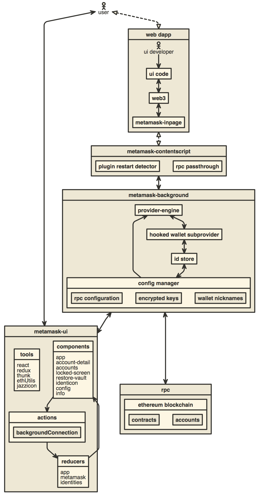

# MetaECF Browser Extension

MetaECF is an Ethereum browser wallet based on MetaMask. Visit [Ethereum Community Foundation](https://ethcf.org/).

MetaECF supports Firefox, Google Chrome, and Chromium-based browsers.

Websites can discover **MetaECF** through [EIP-6963](https://eips.ethereum.org/EIPS/eip-6963), using the stable wallet identifier `org.ethcf.wallet`. Discovery works alongside other installed wallets. For older sites, MetaECF also supplies `window.ethereum` when another provider has not already claimed it. Sites with hardcoded wallet lists may need to add MetaECF explicitly.

The wallet icon uses the [ECF favicon](https://ethcf.org/favicon.svg). The icon and wordmark place the white symbol on a dark background; the PNG toolbar icons are rendered from `ecf-wallet-icon.svg`.

Wallet state and session keys use the browser's extension-scoped storage. MetaECF has its own extension identities, separate from MetaMask:

- Chrome, Brave, and Opera: `gcbminekfcgfihncdagcainadkogbflf`, assigned by the ECF Chrome Web Store listing. Dev and test builds add the listing's public key from `app/manifest/_chromium-dev-key.json`, so unpacked builds get the same ID. Prod builds leave it out, since the store does not accept a manifest `key`.
- Firefox: `wallet@ethcf.org`.

A build with another identity has separate storage and is not automatically migrated. MetaMask's wallet data is not read, copied, or overwritten. Store publishing must use a separate ECF listing.

Internal modules, Redux state, storage keys, and wallet-specific messages use
`ecf-wallet` / `ecfWallet`. Build configuration uses `.ecf-walletrc` and
`ECF_WALLET_*` environment variables. Package coordinates, copyright
notices, and links to third-party resources retain their original names. The four support messages use English fallback in
locales whose previous translation directed users to MetaMask's support inbox.

## Building locally

The extension uses Manifest V3. See [the migration and lifecycle notes](docs/manifest-v3.md)
for browser requirements and service-worker tests.

Usage analytics and remote crash reporting have been removed from this build.
See [the telemetry removal notes](docs/privacy.md) for scope and verification.

- Install [Node.js](https://nodejs.org) version 24.21.0
    - If you are using [nvm](https://github.com/creationix/nvm#installation) (recommended) running `nvm use` will automatically choose the right node version for you.
- Install [Yarn](https://yarnpkg.com/en/docs/install)
- Install dependencies: `yarn`
- Build the project to the `./dist/` folder with `yarn dist`.
- Optionally, to start a development build (e.g. with logging and file watching) run `yarn start` instead.

To load the Chrome build, open `chrome://extensions`, enable **Developer mode**,
click **Load unpacked**, and select `dist/chrome` inside this repository. That
folder contains `manifest.json`. The `builds` folder contains ZIP archives for
distribution; it cannot be loaded directly as an unpacked extension.

## Storage schema

Fresh ecf-wallet storage starts at `meta.version: 0`. Historical MetaMask
migrations and fixtures have been removed; upgrading a MetaMask wallet profile
is not supported. MetaECF's own migrations live in `app/scripts/migrations`.
To add a schema change, run `yarn generate:migration <next version>`, implement
the change and its test, then register it in `app/scripts/migrations/index.js`.

## Contributing

### Running Tests

Run tests with `yarn test`.

You can also test with a continuously watching process, via `yarn watch`.

You can run the linter by itself with `yarn lint`.

## Architecture

[][1]

## Development

```bash
yarn
yarn start
```

## Build for Publishing

```bash
yarn dist
yarn source-package
```

`yarn dist` writes the store packages to `builds/`. `yarn source-package` writes
`builds/ecf-wallet-source-<version>.zip`, the source archive for the
Mozilla Add-ons "source code" upload. It must be run from a clean checkout of the
commit that was built.

## Rebuilding from the source archive

These steps rebuild the Firefox package from `ecf-wallet-source-<version>.zip`.
The extension code is bundled with webpack (`development/build/`) and the CSS is
compiled from Sass. The source tree contains no minified or generated code.
Every dependency comes from the npm registry through `yarn.lock`. A few
dependency files are copied into the package unchanged, as their npm packages
publish them (`development/build/static.js`): `ses/dist/lockdown.umd.min.js`,
the `@trezor/connect-web` web-extension scripts, and the
`@metamask/contract-metadata` token images.

Requirements: Linux or macOS, Node.js 24.21.0 (pinned in `.nvmrc`), and
Yarn 1.22.22.

```bash
unzip ecf-wallet-source-<version>.zip -d ecf-wallet && cd ecf-wallet
yarn install --frozen-lockfile   # dependency install scripts are disabled by .yarnrc
yarn dist
```

The Firefox build is written to `dist/firefox/` and packaged as
`builds/ecf-wallet-firefox-<version>.zip`. Its files match the submitted add-on.
`dist/firefox/build-info.json` records the source commit (read from
`BUILD_COMMIT`) and a SHA-256 hash over every other file in the build.
`node development/verify-build.js dist/firefox` recomputes that hash. The build needs network access only
to download dependencies during `yarn install`.

## Other Docs

- [How to add custom build to Chrome](./docs/add-to-chrome.md)
- [How to add custom build to Firefox](./docs/add-to-firefox.md)
- [How to add a new translation to MetaECF](./docs/translating-guide.md)
- [Publishing Guide](./docs/publishing.md)
- [How to use the TREZOR emulator](./docs/trezor-emulator.md)
- [How to generate a visualization of this repository's development](./development/gource-viz.sh)

[1]: http://www.nomnoml.com/#view/%5B%3Cactor%3Euser%5D%0A%0A%5Becf-wallet-ui%7C%0A%20%20%20%5Btools%7C%0A%20%20%20%20%20react%0A%20%20%20%20%20redux%0A%20%20%20%20%20thunk%0A%20%20%20%20%20ethUtils%0A%20%20%20%20%20jazzicon%0A%20%20%20%5D%0A%20%20%20%5Bcomponents%7C%0A%20%20%20%20%20app%0A%20%20%20%20%20account-detail%0A%20%20%20%20%20accounts%0A%20%20%20%20%20locked-screen%0A%20%20%20%20%20restore-vault%0A%20%20%20%20%20identicon%0A%20%20%20%20%20config%0A%20%20%20%20%20info%0A%20%20%20%5D%0A%20%20%20%5Breducers%7C%0A%20%20%20%20%20app%0A%20%20%20%20%20ecf-wallet%0A%20%20%20%20%20identities%0A%20%20%20%5D%0A%20%20%20%5Bactions%7C%0A%20%20%20%20%20%5BbackgroundConnection%5D%0A%20%20%20%5D%0A%20%20%20%5Bcomponents%5D%3A-%3E%5Bactions%5D%0A%20%20%20%5Bactions%5D%3A-%3E%5Breducers%5D%0A%20%20%20%5Breducers%5D%3A-%3E%5Bcomponents%5D%0A%5D%0A%0A%5Bweb%20dapp%7C%0A%20%20%5Bui%20code%5D%0A%20%20%5Bweb3%5D%0A%20%20%5Becf-wallet-inpage%5D%0A%20%20%0A%20%20%5B%3Cactor%3Eui%20developer%5D%0A%20%20%5Bui%20developer%5D-%3E%5Bui%20code%5D%0A%20%20%5Bui%20code%5D%3C-%3E%5Bweb3%5D%0A%20%20%5Bweb3%5D%3C-%3E%5Becf-wallet-inpage%5D%0A%5D%0A%0A%5Becf-wallet-background%7C%0A%20%20%5Bprovider-engine%5D%0A%20%20%5Bhooked%20wallet%20subprovider%5D%0A%20%20%5Bid%20store%5D%0A%20%20%0A%20%20%5Bprovider-engine%5D%3C-%3E%5Bhooked%20wallet%20subprovider%5D%0A%20%20%5Bhooked%20wallet%20subprovider%5D%3C-%3E%5Bid%20store%5D%0A%20%20%5Bconfig%20manager%7C%0A%20%20%20%20%5Brpc%20configuration%5D%0A%20%20%20%20%5Bencrypted%20keys%5D%0A%20%20%20%20%5Bwallet%20nicknames%5D%0A%20%20%5D%0A%20%20%0A%20%20%5Bprovider-engine%5D%3C-%5Bconfig%20manager%5D%0A%20%20%5Bid%20store%5D%3C-%3E%5Bconfig%20manager%5D%0A%5D%0A%0A%5Buser%5D%3C-%3E%5Becf-wallet-ui%5D%0A%0A%5Buser%5D%3C%3A--%3A%3E%5Bweb%20dapp%5D%0A%0A%5Becf-wallet-contentscript%7C%0A%20%20%5Bplugin%20restart%20detector%5D%0A%20%20%5Brpc%20passthrough%5D%0A%5D%0A%0A%5Brpc%20%7C%0A%20%20%5Bethereum%20blockchain%20%7C%0A%20%20%20%20%5Bcontracts%5D%0A%20%20%20%20%5Baccounts%5D%0A%20%20%5D%0A%5D%0A%0A%5Bweb%20dapp%5D%3C%3A--%3A%3E%5Becf-wallet-contentscript%5D%0A%5Becf-wallet-contentscript%5D%3C-%3E%5Becf-wallet-background%5D%0A%5Becf-wallet-background%5D%3C-%3E%5Becf-wallet-ui%5D%0A%5Becf-wallet-background%5D%3C-%3E%5Brpc%5D%0A
